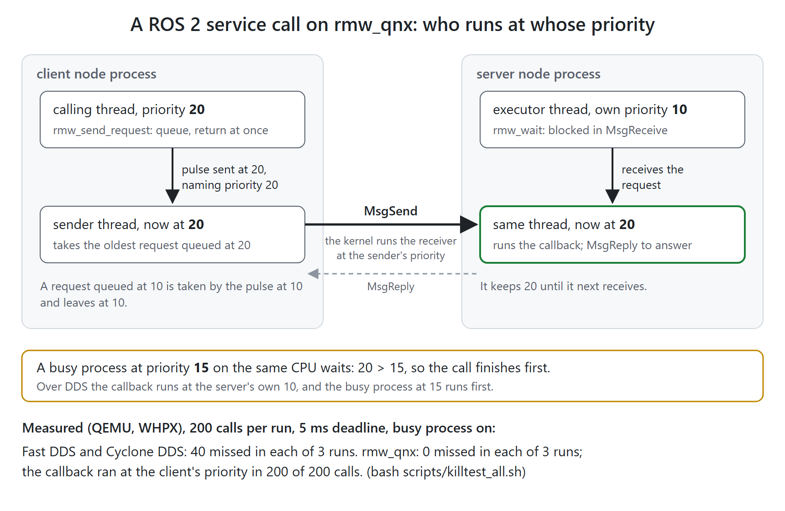

# rmw_qnx

[](https://github.com/Marc-Dvci/rmw_qnx/actions/workflows/tests.yml)
[](LICENSE)
[](docs/RESULTS.md#3-host-tests-of-the-core)
[](docs/RESULTS.md#3-host-tests-of-the-core)
[](#build-and-run)

**A ROS 2 middleware for QNX 8.0 that carries messages through the kernel's own message passing, so a robot's
high-priority node stays high-priority when it calls a low-priority one.** For teams running ROS 2 on QNX who need
a safety node's request to beat background work.

An application changes one line, and no code:

```sh
export RMW_IMPLEMENTATION=rmw_qnx
```

| Track | Built with | Headline (QEMU, WHPX) |
|---|---|---|
| Open-Source Contribution & Ports | QNX SDP 8.0, ROS 2 Jazzy, `MsgSend`/`MsgReply`, pulses, a resource manager, `tracelogger` | Under a medium-priority load, a priority-20 client's ROS 2 service calls missed their 5 ms deadline **40 times in 200** on Fast DDS and on Cyclone DDS, in each of three runs, and **0 times** on rmw_qnx in each of three runs. On rmw_qnx the server's callback ran at the client's priority in all 600 calls. |

rmw_qnx runs inside QNX 8.0: every session and figure below is recorded from a QNX 8.0 guest.

[For judges](#for-judges) · [See it work](#see-it-work) · [How it works](#how-it-works) ·
[Evidence of QNX use](#evidence-of-qnx-use) · [Evidence](#evidence) · [Build and run](#build-and-run)

## For judges

| Criterion | Where it is answered |
|---|---|
| Technological implementation | The service path in [`rmw_qnx.cpp`](https://github.com/Marc-Dvci/rmw_qnx/blob/v1.0.0/rmw_qnx/src/rmw_qnx.cpp): [`rmw_send_request`](https://github.com/Marc-Dvci/rmw_qnx/blob/v1.0.0/rmw_qnx/src/rmw_qnx.cpp#L1361-L1386) (a pulse at the caller's priority), [`sender_main`](https://github.com/Marc-Dvci/rmw_qnx/blob/v1.0.0/rmw_qnx/src/rmw_qnx.cpp#L586-L639) (`MsgSendv`), [`rmw_wait`](https://github.com/Marc-Dvci/rmw_qnx/blob/v1.0.0/rmw_qnx/src/rmw_qnx.cpp#L1053-L1169) (`MsgReceive`), [`rmw_send_response`](https://github.com/Marc-Dvci/rmw_qnx/blob/v1.0.0/rmw_qnx/src/rmw_qnx.cpp#L1269-L1300) (`MsgReplyv`); topics in [`topics.hpp`](https://github.com/Marc-Dvci/rmw_qnx/blob/v1.0.0/rmw_qnx/src/topics.hpp); the host-tested core in [`rmw_qnx/core/`](rmw_qnx/core); [porting notes](docs/PORTING_NOTES.md) |
| Design | One environment variable; the graph as files: [`ros2graphd.cpp`](https://github.com/Marc-Dvci/rmw_qnx/blob/v1.0.0/rmw_qnx/src/ros2graphd.cpp#L433-L462) mounts `/dev/ros2`, [`render_topic`](https://github.com/Marc-Dvci/rmw_qnx/blob/v1.0.0/rmw_qnx/src/ros2graphd.cpp#L204-L258) answers `cat` ([session](docs/dev_ros2_session.txt)); ROS 2's `pendulum_control` demo unchanged ([result](docs/RESULTS.md#1d-the-pendulum-demo-unchanged)) |
| Potential impact | [The problem](#the-problem) |
| Innovation | Priority inheritance carried through ROS 2's asynchronous service call ([How it works](#how-it-works)) |
| Best use of QNX-specific technologies | [Evidence of QNX use](#evidence-of-qnx-use): message passing, pulses, a resource manager, the instrumented kernel |

## See it work

The graph is a QNX resource manager, so the shell is the browser
([recorded session](docs/dev_ros2_session.txt), `bash scripts/dev_ros2_demo.sh`):

```
# ls /dev/ros2/topics
chatter
parameter_events

# cat /dev/ros2/topics/chatter
topic:        /chatter
type:         example_interfaces/msg/String
publishers:   1
subscribers:  1
written:      108 messages since the topic was created
transport:    shared-memory ring, 64 slots of 16384 bytes, /rmwqnx.d0.%2Fchatter
latest:       message 108 in the ring, number 21 from its publisher
  data: hello 21

# cat /dev/ros2/services/inversion
service:      /inversion
server:       pid 1310744, channel 1, service 2
transport:    MsgSend/MsgReply: the server's thread runs at the calling client's priority
```

The kill test, with one command (`bash scripts/killtest_all.sh`, [full output](results/inversion-ros2-20261107-080444.txt)),
loaded runs:

```
RESULT rmw=rmw_fastrtps_cpp   requests=200 misses=40 contended=40 load_ran_first=40 served_at_client_prio=0
RESULT rmw=rmw_cyclonedds_cpp requests=200 misses=40 contended=40 load_ran_first=40 served_at_client_prio=0
RESULT rmw=rmw_qnx            requests=200 misses=0  contended=80 load_ran_first=0  served_at_client_prio=200
```

(one of three runs per middleware shown; columns trimmed for width.) The kernel's own trace of one run each
(`scripts/trace_decode.sh results/trace-ros2-20261107-080641` in WSL, then
`python scripts/trace_summary.py results/trace-ros2-20261107-080641/<rmw>.trace results/trace-ros2-20261107-080641/<rmw>.pinv --threads`):

```
rmw_fastrtps_cpp:   load held CPU 0 for more than 1 ms before the server's thread ran 21 times
rmw_cyclonedds_cpp: load held CPU 0 for more than 1 ms before the server's thread ran 21 times
rmw_qnx:            load held CPU 0 for more than 1 ms before the server's thread ran 0 times
```

## The problem

ROS 2 on QNX today talks through DDS: QNX's own ROS 2 Jazzy port builds Fast DDS, Cyclone DDS and Connext
([qnx-ports/build-files](https://github.com/qnx-ports/build-files/tree/main/ports/ros2)). DDS moves bytes over UDP
or shared memory. When a safety node at high priority calls a service hosted by a low-priority node, the request
waits until the service's thread runs at its own low priority, and any medium-priority work on the same CPU runs
first. That is priority inversion between nodes, and the RTOS underneath has the mechanism to prevent it: QNX message
passing runs the receiving thread at the sender's priority. This project puts ROS 2 on that mechanism.

## How it works



([source](docs/priority-path.svg), rendered with `python scripts/render_diagram.py docs/priority-path.svg`)

Topics take a different path: the publisher writes a shared-memory ring per topic and sends each subscriber a pulse
at that subscriber's own priority. `/dev/ros2` (ros2graphd, a resource manager) reads the rings, the service
registry and the graph files on every open.

| ROS 2 concept | rmw_qnx | QNX mechanism |
|---|---|---|
| Service call | rcl's request call must not block, so `rmw_send_request` queues the request with the caller's priority and sends the client's sender thread a pulse at that priority; that thread, now at the caller's priority, takes the oldest request of that priority ([`core/sendq.hpp`](rmw_qnx/core/sendq.hpp)) and does `MsgSend` to the server's context channel; the server thread blocked in `MsgReceive` inside `rmw_wait` takes that priority, runs the callback, and `rmw_send_response` replies | `MsgSendPulse` with priority -1, `MsgSendv`, `MsgReceive`, `MsgReplyv`, priority inheritance on the channel |
| Wait set | `rmw_wait` blocks in `MsgReceive` on one channel; guard conditions and topics wake it with pulses at the waiting thread's own priority | `ChannelCreate`, `ConnectAttach`, `TimerTimeout` |
| Topic | A shared-memory ring per topic ([`topics.hpp`](rmw_qnx/src/topics.hpp) over [`core/ring.hpp`](rmw_qnx/core/ring.hpp)); the publisher serialises once, never blocks, and pulses each subscriber at the priority that subscriber registered with | `shm_open`, `mmap`, `MsgSendPulse`, `MsgReceivePulse` |
| Graph | Each context writes its nodes and endpoints to a graph file and pulses the other contexts, whose nodes' graph guard conditions then fire; the graph queries read the files of live processes. `ros2graphd` serves `/dev/ros2/nodes`, `/dev/ros2/topics` and `/dev/ros2/services`, rendered fresh on every open; a topic's latest message is decoded with its type's own introspection library | `resmgr_attach`, `iofunc` layer, `_IO_XTYPE_READDIR`, `MsgSendPulse` |
| QoS events | A deadline is a QNX timer that delivers a pulse to the context's relay thread; the relay wakes the wait set, so no thread polls | `timer_create` with a pulse event, `MsgSendPulse` |
| Serialisation | CDR from the C++ introspection type support, with a bounds-checked reader ([`core/cdr.hpp`](rmw_qnx/core/cdr.hpp)) | |

Plain logic (ring, CDR, name encoding, graph bookkeeping, QoS rules, the send queue) lives in
[`rmw_qnx/core/`](rmw_qnx/core), compiles on any host, and is tested there.

## Evidence of QNX use

| QNX technology | File and function | What it does here |
|---|---|---|
| Message passing with priority inheritance | [`rmw_qnx.cpp`](rmw_qnx/src/rmw_qnx.cpp): `sender_main` (`MsgSendv`), `rmw_wait` (`MsgReceive`), `accept_request`, `rmw_send_response` (`MsgReplyv`) | The server's callback runs at the client's priority: 600 of 600 loaded calls |
| Pulses carrying a priority | `rmw_send_request` (`MsgSendPulse(coid, -1, ...)`), `Waitable::notify`, `Topic::publish` in [`topics.hpp`](rmw_qnx/src/topics.hpp), `relay_main` | A caller's priority reaches the thread that blocks for it; subscribers wake at their own priority |
| Resource manager | [`ros2graphd.cpp`](rmw_qnx/src/ros2graphd.cpp): `main` (`resmgr_attach` on `/dev/ros2`), `io_open`, `io_read`, `render_topic` | `ls` and `cat` on the live ROS 2 graph |
| Shared memory | `Topic::Topic` (`shm_open`, `mmap`) | One ring per topic, read by every subscriber and by `/dev/ros2` |
| Instrumented kernel and `tracelogger` | [`qnx/image/build.sh`](qnx/image/build.sh) (`procnto-smp-instr -P 22`), [`scripts/guest/run_inversion.sh`](scripts/guest/run_inversion.sh), [`scripts/trace_summary.py`](scripts/trace_summary.py) | The kernel's own record of who ran first |
| Run masks and priorities | `become`, `pin_this_thread` in [`inversion.cpp`](bench/inversion_ros2/src/inversion.cpp); `become` in [`pinv.c`](bench/pinv/pinv.c) | The measured threads share CPU 0, so priority alone decides who runs |
| `mkqnximage` | [`qnx/image/build.sh`](qnx/image/build.sh) | The guest image |

## Scope

rmw_qnx connects the ROS 2 processes of one QNX system: every service call travels by `MsgSend` and `MsgReply`, and
every message through a shared-memory ring woken by pulses. Topics and services carry the types that ship with the
C++ introspection type support. Offered-deadline and matched QoS events are raised from QNX timer pulses and graph
pulses. The interface details, call by call, are in [RESULTS §1g](docs/RESULTS.md#1g-qos-events-from-qnx-timers) and
[the per-suite results](docs/RESULTS.md#1e-ros-2s-own-rmw-test-suite).

Every figure is a count (deadline misses, the priority a thread ran at, who ran first), measured in QEMU with WHPX.

## Evidence

All guest figures are QEMU, WHPX, and each has its command in [`docs/RESULTS.md`](docs/RESULTS.md). Each row names
the check that fails if the claim stops being true: a host test, or the guest command itself.

| Claim | Measured | Command | Recorded output | Code | Test |
|---|---|---|---|---|---|
| A medium load delays a high-priority ROS 2 client on DDS and not on rmw_qnx | Loaded misses: Fast DDS 40, 40, 40; Cyclone DDS 40, 40, 40; rmw_qnx 0, 0, 0 (of 200) | `bash scripts/killtest_all.sh` | [`inversion-ros2-20261107-080444.txt`](results/inversion-ros2-20261107-080444.txt) | [`rmw_qnx.cpp`](rmw_qnx/src/rmw_qnx.cpp) | [`run_inversion.sh`](scripts/guest/run_inversion.sh) (guest) |
| Across every recorded loaded run, the load never delays an rmw_qnx call | rmw_qnx 3 misses in 3,000 calls, load finished first in 0 of 1,200 mid-burst calls; Cyclone DDS 520 in 2,600; Fast DDS 360 in 1,800 | as above, repeated | [RESULTS §1](docs/RESULTS.md#1-the-kill-test-priority-inversion-through-ros-2) | | same |
| The server's callback runs at the client's priority | 200 of 200 in every rmw_qnx run; 0 on DDS | same | same | `rmw_wait`, `sender_main` | same |
| The kernel's trace agrees | Load held CPU 0 for more than 1 ms before the server's thread: 21, 21, 0 waits | `bash scripts/killtest_all.sh`, then the two trace commands above | [`trace-ros2-20261107-080641/`](results/trace-ros2-20261107-080641) | [`trace_summary.py`](scripts/trace_summary.py) | [`tests/tools`](tests/tools/test_trace_summary.py) (11) |
| The same property holds at the transport level | MsgSend 0 misses; UDP and shared memory 40 of 200 | `bash scripts/pinv_run.sh 200` | [`pinv-20261107-002853.txt`](results/pinv-20261107-002853.txt) | [`pinv.c`](bench/pinv/pinv.c) | [`pinv_run.sh`](scripts/pinv_run.sh) (guest) |
| Each caller is served at its own priority, even two on one client | Callers at 10 and 20 on one client: each served at its own priority | `bash scripts/rmw_checks.sh` | [`rmw_checks-20261107-080329.txt`](results/rmw_checks-20261107-080329.txt) | [`core/sendq.hpp`](rmw_qnx/core/sendq.hpp) | [`test_sendq.cpp`](tests/core/test_sendq.cpp), [`rmw_checks.cpp`](bench/inversion_ros2/src/rmw_checks.cpp) |
| `pendulum_control` runs unchanged | Exit 0; 998 and 998 messages received on rmw_qnx | `bash scripts/pendulum_run.sh 2000` | [`pendulum-20261107-062433.txt`](results/pendulum-20261107-062433.txt) | | [`pendulum_run.sh`](scripts/pendulum_run.sh) (guest) |
| QoS deadline events come from a QNX timer pulse | A quiet publisher with a 100 ms deadline raises 4 events in 450 ms; a healthy one raises none; matched events report a join and a leave | `bash scripts/rmw_checks.sh` | [`rmw_checks-20261107-080329.txt`](results/rmw_checks-20261107-080329.txt) | [`core/qos.hpp`](rmw_qnx/core/qos.hpp) | [`test_qos.cpp`](tests/core/test_qos.cpp), [`rmw_checks.cpp`](bench/inversion_ros2/src/rmw_checks.cpp) |
| Hostile input is refused | The 33rd subscription on a topic, a forged nested length and a null buffer are refused; a destroyed topic is gone and its name takes another type; graph queries see another process: 9 of 9 guest checks pass | `bash scripts/rmw_checks.sh` | [`rmw_checks-20261107-080329.txt`](results/rmw_checks-20261107-080329.txt) | [`core/cdr.hpp`](rmw_qnx/core/cdr.hpp), [`core/graph.hpp`](rmw_qnx/core/graph.hpp) | [`rmw_checks.cpp`](bench/inversion_ros2/src/rmw_checks.cpp) |
| ROS 2's own `test_rmw_implementation` | 100 of 125 tests pass on rmw_qnx ([by suite](docs/RESULTS.md#1e-ros-2s-own-rmw-test-suite)) | `bash scripts/rmw_suite.sh` | [`test_rmw_implementation-20261107-080334.txt`](results/test_rmw_implementation-20261107-080334.txt) | | the suite itself |
| Topics cross processes | 20 of 20 messages, in order | `bash scripts/topics_check.sh 20` | [`topics-20261107-064727.txt`](results/topics-20261107-064727.txt) | [`topics.hpp`](rmw_qnx/src/topics.hpp) | [`topics_check.sh`](scripts/topics_check.sh) (guest) |
| `/dev/ros2` lists the graph and decodes the latest message | Recorded session | `bash scripts/dev_ros2_demo.sh` | [`dev_ros2_session.txt`](docs/dev_ros2_session.txt) | [`ros2graphd.cpp`](rmw_qnx/src/ros2graphd.cpp) | [`test_names.cpp`](tests/core/test_names.cpp), [`test_graph.cpp`](tests/core/test_graph.cpp) |
| A reader never takes a torn or repeated message; a lapped reader counts what it lost | Property tests over random interleavings and a racing writer | `scripts/host_tests.sh` | CI | [`core/ring.hpp`](rmw_qnx/core/ring.hpp) | [`test_ring.cpp`](tests/core/test_ring.cpp) |
| Truncated or forged CDR fails without reading past the buffer | Every truncation of 200 random messages; 20,000 random hostile buffers under AddressSanitizer | `SANITIZE=1 scripts/host_tests.sh` | CI | [`core/cdr.hpp`](rmw_qnx/core/cdr.hpp) | [`test_cdr.cpp`](tests/core/test_cdr.cpp) |
| The core's tests catch deliberate faults | 12 of 12 mutants killed | `scripts/mutation_check.sh` | [`mutation_check-20261107-072525.txt`](results/mutation_check-20261107-072525.txt) | [`core/`](rmw_qnx/core) | [`mutation_check.sh`](scripts/mutation_check.sh) |

Tests: 63 host tests of the core (GoogleTest, random order, including property tests; 96.3 % of its lines, 71.1 % of
its branches by gcovr 8.8, [transcript](results/host_tests-20261107-072606.txt)) and 11 tests of the trace tool
(pytest, random order). The guest runs above are the integration and end-to-end tests. CI runs the host tests with
coverage, lint, format, spelling and link checks on every push.

> [!IMPORTANT]
> Real: QNX 8.0's kernel, ROS 2 Jazzy, Fast DDS, Cyclone DDS and rmw_qnx, all running in a QNX 8.0 guest; every
> figure is read from a transcript in [`results/`](results).

The scenario is in [RESULTS §1](docs/RESULTS.md#1-the-kill-test-priority-inversion-through-ros-2): a client at
priority 20, a server at 10 doing 1 ms of work, and a load at 15 busy 20 ms of every 50, all on CPU 0. Porting notes,
each with its reproduction, are in [`docs/PORTING_NOTES.md`](docs/PORTING_NOTES.md), including a QNX 8.0 x86_64
`memchr` behaviour that stopped every ROS 2 process.

## Build and run

- **QNX version:** QNX SDP 8.0, free QNX Everywhere licence
- **Target:** QEMU x86_64 (`-accel whpx`, 2 vCPUs, 4 GB)
- **Toolchain:** `qcc`/`q++`, GCC 12.2.0 (`gcc_ntox86_64`, `gcc_ntox86_64_cxx`), CMake and colcon, on Ubuntu 22.04
  (WSL on Windows here)

### Prerequisites

1. **A free QNX Everywhere licence and QNX SDP 8.0.** Create a myQNX account at <https://www.qnx.com/>, request the
   free non-commercial QNX Everywhere licence (<https://www.qnx.com/products/everywhere/>), then install the QNX
   Software Center for Linux and, with it, QNX SDP 8.0 into `~/qnx800`. The scripts source `~/qnx800/qnxsdp-env.sh`;
   the licence must be activated in the Software Center for `qcc` to run.
2. **Ubuntu 22.04** (native or WSL) with `build-essential cmake git python3-venv openssh-client`; `qnx/ros2/fetch.sh`
   makes the Python environment colcon needs.
3. **QEMU** with KVM on Linux, or QEMU for Windows with the Windows Hypervisor Platform turned on, and Git Bash (its
   `ssh`) to drive the guest. `qnx/run_whpx.ps1` runs `qemu-system-x86_64.exe` from the `PATH`; set `QEMU` to its full
   path to use another one.
4. The guest's ssh key is made by `qnx/stage1.sh` on first use, in `.guest/ssh/` (not committed).

```sh
# In Ubuntu, with the SDP at ~/qnx800:
bash qnx/stage1.sh            # guest image (mkqnximage) and the transport-level test
bash qnx/ros2/fetch.sh        # ROS 2 Jazzy sources and QNX's patches, from qnx-ports/build-files
bash qnx/ros2/build.sh        # cross-builds the ROS 2 subset, with this repository's patches (qnx/ros2/patches)
bash qnx/ros2/build.sh ~/rmw_qnx-work rmw_fastrtps_cpp pendulum_control
bash qnx/ros2/build_ours.sh   # rmw_qnx, ros2graphd and the scenarios; packs them for the guest
scripts/host_tests.sh         # host tests of the core (any Linux, no SDP)
```

```sh
# In Git Bash on Windows (QEMU with WHPX; on Linux use KVM with the same QEMU arguments):
bash scripts/killtest_all.sh              # the kill test, three middlewares, three runs each, traced
bash scripts/inversion_ros2.sh up         # boot the guest for the demos below
bash scripts/dev_ros2_demo.sh             # /dev/ros2 session
bash scripts/pendulum_run.sh 2000         # pendulum_control, unchanged
bash scripts/inversion_ros2.sh down
```

On the guest, any ROS 2 program uses rmw_qnx with `RMW_IMPLEMENTATION=rmw_qnx`, and `ros2graphd &` mounts
`/dev/ros2`.

Host tooling only (Python 3.12, no SDP): `python -m venv .venv`, then `. .venv/bin/activate` (Linux) or
`.venv\Scripts\activate` (Windows), `pip install -r requirements-dev.txt` and `python -m pytest -q`.

## Upstream

This is a new repository with the RMW layer, the QNX build files, patches, instructions and docs. It is not a fork
and holds no upstream history.

- ROS 2 middleware interface it implements: <https://github.com/ros2/rmw> (Jazzy)
- QNX's ROS 2 port, whose patches and toolchain file the build fetches: <https://github.com/qnx-ports/build-files>
- Demos run unchanged: <https://github.com/ros2/demos>; real-time support (`rttest`): <https://github.com/ros2/realtime_support>
- Patches this repository applies to upstream sources at build time: [`qnx/ros2/patches/`](qnx/ros2/patches)

No public RMW implementation over QNX message passing was found in a search of GitHub, qnx-ports and openqnx.

## Layout

- `rmw_qnx/` the ROS 2 package: `src/` the middleware layer and `ros2graphd`, `core/` the host-testable logic
- `bench/pinv/` the transport-level test; `bench/inversion_ros2/` the ROS 2 scenario and the guest checks
- `qnx/` image build, boot, ssh, ROS 2 cross-build and patches
- `scripts/` test runs, guest-side scripts, trace decoding and summary
- `tests/core/` host tests (GoogleTest); `tests/tools/` tests of the trace summary (pytest)
- `results/` recorded runs; `docs/` results, porting notes, recorded sessions

## License

[Apache-2.0](LICENSE), as ROS 2.
